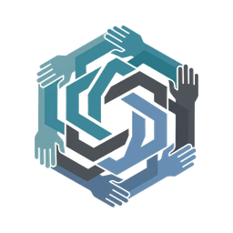

<p align="center"></p>

# CollabNET: Interactive Bibliometric Collaboration & Social Network Analysis

[](https://vizkidd.github.io/collabnet/)
[](LICENSE)
[](#architecture)
[](README_MCP.md)

**CollabNET** is a high-performance, client-side bibliometric and social network analysis platform compiled to WebAssembly (WASM via Shinylive). It empowers researchers, bibliometricians, and research institutions to analyze co-authorship networks, research impact, interdisciplinary intersections, and topological graph-theoretic properties directly inside the web browser—without requiring a dedicated analysis server for browser-side file workflows. Live metadata lookups and optional AI integrations require network access; privacy depends on which external services and AI providers the user chooses to invoke.

Live application: **[https://vizkidd.github.io/collabnet/](https://vizkidd.github.io/collabnet/)**

---

## 🌟 Key Features

### 1. Zero-Backend Ingestion & Portability
- **Live Resolvers**: Instant asynchronous publication and metadata extraction via ORCiD (v3.0 REST API), Scopus Author ID / Document Search, OpenAlex, and Crossref.
- **Universal File Ingestion**: Intelligent column mapping wizard for Scopus CSV, Web of Science (WoS), PubMed, Lens.org, and custom CSV/Excel files.
- **Session Persistence (`.cnet` v2)**: gzipped JSON with a schema version. It holds the data table, source metadata, retrieval time, filter, counting, community and layout settings, and the app/R/igraph versions. It is validated strictly on load. Legacy binary (RDS) `.cnet`/`.rds` files are refused, because R deserialisation of untrusted files can execute code.
- **Tabular Exports**: Publication tables exportable to CSV, Excel, PDF, and clipboard via DataTables Buttons.

### 2. Rigorous Graph Theory & Network Topologies
- **Newman Fractional Weighting**: Edge weights between co-authors scaled inversely by the number of authors per publication:
  $$w_{ij} = \sum_{p \in P_{ij}} \frac{1}{N_p - 1}$$
- **Centrality Suite**: Node-level Degree, Betweenness, Closeness, Eigenvector centrality, PageRank, and k-Core decomposition.
- **Hamiltonian Graph Diagnostics**: Automated validation of Ore's Theorem and Dirac's Theorem for Hamiltonian cycle existence in collaboration components:
  - **Ore's Condition**: $\deg(u) + \deg(v) \ge |V|$ for every pair of non-adjacent vertices.
  - **Dirac's Condition**: $\deg(v) \ge \frac{|V|}{2}$ for all vertices.
- **Cut-Vertex & Articulation Point Detection**: Identifies critical collaboration gatekeepers whose departure would partition the network.
- **Dynamic Ego Networks**: One-click egocentric neighborhood extraction for selected authors.

### 3. Boolean Relationship Gates
Combine multiple focal authors or lookup keywords using propositional logic gates:
- **OR (Co-patriot/Collaborator)**: Publications containing *any* selected keyword.
- **AND (Companion)**: Publications where *all* focal entities co-authored together.
- **XOR (Rival)**: Publications authored by *strictly one* focal author (zero overlap).
- **NOR (Ignore)**: Publications authored by collaborators *excluding* the focal authors.
- **NAND (Divide & Exclude)**: Exclude publications that feature all focal entities simultaneously.
- **FULL (Unfiltered)**: Full dataset preserved with target authors annotated.

### 4. Overlap & Interdisciplinary Analysis
- High-resolution Venn diagrams and UpSet-style intersection plots across keywords, research departments, or publication venues.
- Dynamic publication and citation contribution trends stratified by OpenAlex citedness bands (Q1–Q4 by fixed cut-offs on 2-year mean citedness: ≥4, ≥2, ≥0.75, >0; not JCR quartiles) and authorship position (First, Second, Corresponding, Co-Author).

### 5. Single-threaded by design
- All computation runs in webR (single-threaded R in WebAssembly). An earlier JavaScript Web Worker Pool was never wired to R and was removed in 2.2.0 (P2-6); large graphs rely on exact-but-efficient igraph routines and opt-in approximations.

## 🏗️ Architecture

```
┌──────────────────────── Browser tab ────────────────────────┐
│ Shinylive / webR (single-threaded R in WebAssembly)         │
│  • Shiny reactive engine      • igraph graph engine          │
│  • visNetwork rendering       • DataTables UI tables         │
│  • MCP registry (GScholarLENS-MCP.R) ⇄ collabnet-webmcp.js   │
└──────────────────────────────────────────────────────────────┘
```

CollabNET operates as a standalone Single Page Application (SPA). Shinylive loads an in-browser webR engine compiled with Emscripten. Imported data and graph calculations are handled in the browser session. However, optional metadata resolvers contact their respective external APIs, and optional AI features send the context/results selected by the user to the configured provider. Do not assume every workflow is offline or that no information leaves the browser.

---

## 🚀 Quick Start

### Online (Recommended)
Navigate to [https://vizkidd.github.io/collabnet/](https://vizkidd.github.io/collabnet/) in any modern desktop browser (Chrome, Firefox, Safari, Edge).

### Local Browser Hosting
1. Clone the repository:
   ```bash
   git clone https://github.com/vizkidd/collabnet.git
   cd collabnet
   Rscript -e "source('buildWASM.R')"
   ```
2. Serve the `wasm_build` folder with any local web server:
   ```bash
   python3 -m http.server 8000 --directory wasm_build
   ```
3. Open `http://localhost:8000` in your browser.

---

## 📚 Documentation & Manual
For full mathematical formulations, tutorial walkthroughs, and step-by-step guidance, refer to the [MANUAL.md](MANUAL.md) or click the **Manual** button in the dashboard top navigation.

## 📄 License
This project is licensed under the MIT License. See [LICENSE](LICENSE) for details.
